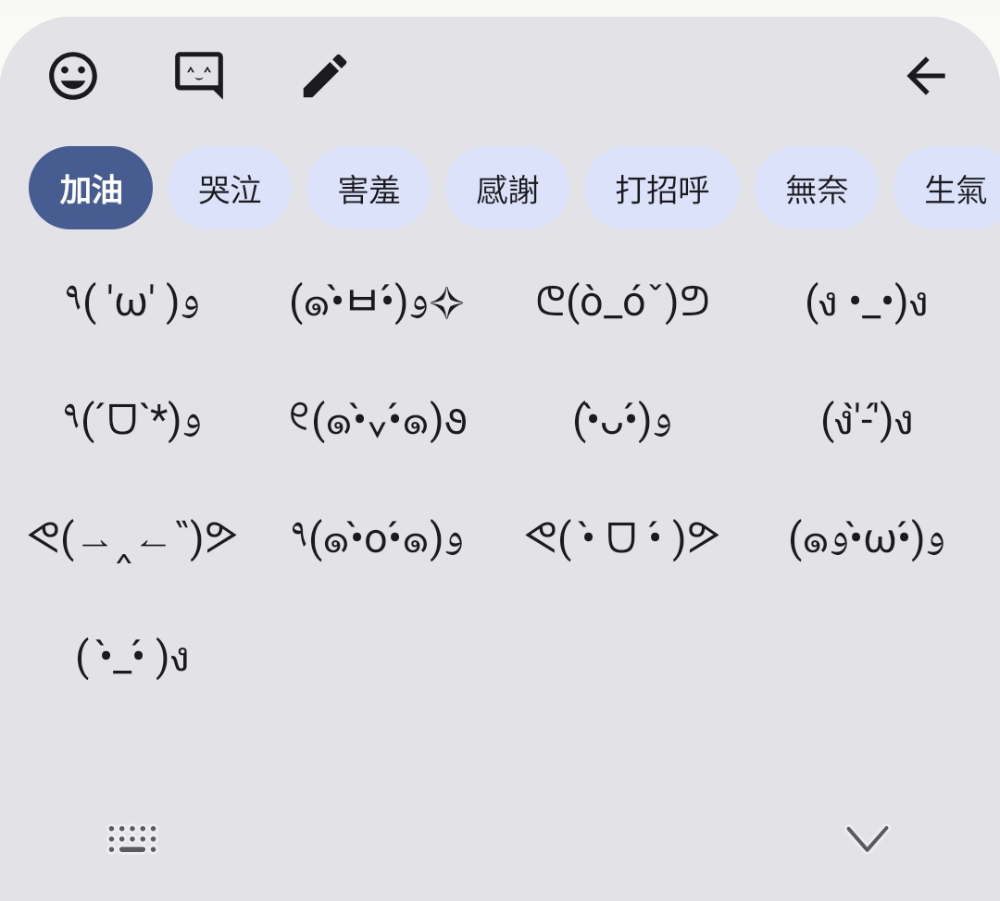
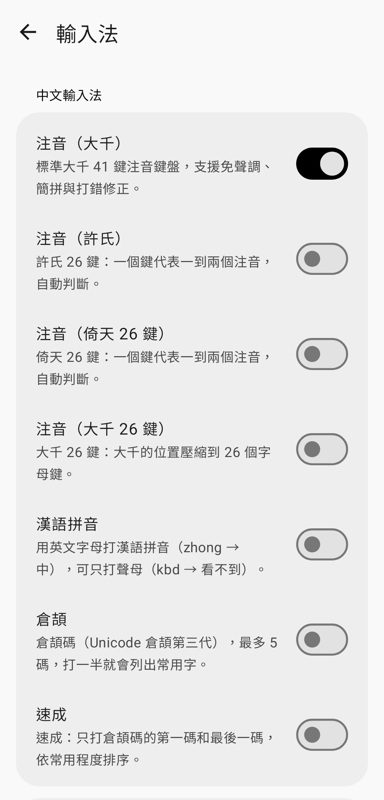

<p align="center">
  
</p>

<h1 align="center">Scorpio 智慧注音</h1>

<p align="center">Android 注音輸入法：整句選字、免聲調、打錯也猜得到，詞庫可以分開開關、匯入匯出。<br>
<b>不蒐集任何資料、打字與學習全部在手機上、不要求任何需要你同意的權限。</b></p>

<p align="center">
  
  
  
</p>
<p align="center">
  
</p>

---

## 隱私

| | |
|---|---|
| **不蒐集資料** | 沒有分析、追蹤、廣告、當機回報，也沒有帳號。手寫辨識用的 Google ML Kit 附帶的使用統計上傳也已經拿掉（見下方說明）。 |
| **全部在手機上** | 打的字、學習紀錄、自建詞、按鍵校正、匯入的詞庫都只存在手機裡，不會上傳到任何地方。 |
| **不要求權限** | 不需要麥克風、聯絡人、定位、儲存空間、相機等任何需要你同意的權限；用不到就不會跳出詢問。 |

App 只在這幾種情況連網，而且都只是「下載」，不送出你的任何資料：

- **詞庫線上更新**：每天在 Wi-Fi 下讀一次 GitHub 上[資料 repo](https://github.com/ScorpionSkypoo/scorpio-ime-data) 的公開檔案，可以在設定關掉。
- **擴充功能**：你在設定裡按「安裝」時，從同一個資料 repo 下載。
- **檢查 App 更新**：讀 GitHub Releases 的最新版本；下載安裝前會先問你。
- **手寫辨識**：第一次使用手寫時，從 Google 下載離線辨識模型；之後辨識都在手機上進行。

文字工具類擴充功能的「Google 搜尋」「Google 翻譯」等項目，只有你按下去時才會用瀏覽器開啟，並帶上你當時選取的文字。

<details>
<summary>權限明細</summary>

| 權限 | 誰加的 | 用途 | 會不會詢問 |
|---|---|---|---|
| `INTERNET` | App | 上面列的下載 | 不會（一般權限） |
| `REQUEST_INSTALL_PACKAGES` | App | 下載 App 更新後交給系統安裝 | 只有你按「下載並安裝」時，系統會請你允許「安裝未知應用程式」 |
| `ACCESS_NETWORK_STATE`、`WAKE_LOCK`、`RECEIVE_BOOT_COMPLETED`、`FOREGROUND_SERVICE` | AndroidX WorkManager | 「只在 Wi-Fi 下」每天檢查一次詞庫更新、重開機後恢復排程 | 不會（一般權限） |

**關於 Google ML Kit**：手寫辨識用的 ML Kit 預設會透過 datatransport（ClearCut）回報匿名使用統計給 Google。`AndroidManifest.xml` 已經移除它的上傳後端（`TransportBackendDiscovery`），統計事件沒有地方送，會直接丟掉；辨識本身不受影響。
</details>

## 功能

### 打字
- **整句選字**：依詞庫和前後文，用 Viterbi 一次挑出整句最通順的組合；第一個候選就是整句，長句也能一次選完。
- **免聲調、簡拼**：可以不打聲調，也可以只打聲母，例如 `ㄎㄅㄉ` → 看不到、`ㄏㄏ` → 哈哈。
- **打錯也猜得到**：落點只調整權重、不直接關掉鄰鍵，拼不起來時換鄰鍵重新組字；常打錯的注音（例如 `ㄉㄨㄠ` → `ㄉㄧㄠ`）選過一次正確的字就記住。
- **個人化按鍵校正**：記住你按每個鍵時習慣偏哪個方向，收集約 300 次按鍵後建立基準，之後持續微調。
- **越打越順**：選過的字詞和詞與詞的搭配會往前排；系統詞典沒有、你自己打出來的詞會標小鉛筆，長按可刪除。
- **「，」長按輸入「。」**；也可以開常駐數字列。
- **分組選字**：打超過 4 個音節時，展開面板只列從開頭算起的詞，一組一組往下選（比照 Gboard）。

### 輸入法
- 注音：大千 41 鍵、許氏 26 鍵、倚天 26 鍵、大千 26 鍵
- 漢語拼音（可只打聲母，`kbd` → 看不到）
- 倉頡、速成
- 手寫（Google ML Kit 離線辨識，第一次使用時下載模型）
- 英文：4.7 萬字補全、鄰鍵容錯、接續詞
- Emoji（依中文詞意聯想）與 1,500 多個顏文字（28 個分類）

### 工具列與擴充功能
- 工具列排列是「工具｜最近使用的 Emoji 與顏文字（可左右滑）｜設定」。
- 工具（Emoji、顏文字、手寫與安裝的擴充功能）用開關決定顯示、拖拉調整順序，也可以全部關掉。
- **擴充功能**可以線上安裝：日期時間、常用符號、文字工具（全形半形、大小寫、Google 搜尋、翻譯、萌典…）。擴充功能是宣告式 JSON，只能插入文字、轉換選取的文字、用選取的文字開網址，不含程式碼，也讀不到你打的字。格式見[資料 repo](https://github.com/ScorpionSkypoo/scorpio-ime-data#擴充功能工具列外掛)。

### 詞庫
- **開關就是安裝**：主詞庫之外，流行用語、台灣地名路名、台灣景點、世界地名、世界地標、Emoji、顏文字都能各自開關；開著的才會自動更新。點進去可以搜尋瀏覽詞庫內容。
- **可下載的詞庫**（不內建、預設不裝）：教育部國語辭典（約 8.3 萬詞，含成語）、資訊工程術語（約 4 萬詞），打開開關才下載。
- **接續詞依來源拆開**：維基百科、PTT、Dcard 三份語料各自開關，只影響整句選字和選完字後聯想的下一個詞。
- **線上更新**：每天在 Wi-Fi 下自動檢查新版，見〈詞庫與線上更新〉；流行用語每週由新詞雷達更新。
- **匯入、匯出**：見下面的〈匯入詞庫〉。匯入的詞存在獨立檔案，App 改版換詞庫也不會不見。
- **每個詞庫都寫清楚來源與授權**，見 [DATA_LICENSES.md](DATA_LICENSES.md)。

### 介面
- 鍵盤主題：動態取色（跟著桌布）、經典、淺色、深色、照片背景（可調暗、調透明度）
- 按鍵底色、按鍵邊框、上方圓角都可以開關；按鍵預覽泡泡、按鍵高度、震動回饋
- 設定 App 採用 Material 3，跟著桌布配色；調整鍵盤相關設定時，上方有試打框、鍵盤即時更新
- 檢查 App 更新：從 GitHub Releases 下載新版

## 安裝

到 [Releases](https://github.com/ScorpionSkypoo/ScorpionBopomofo/releases) 下載 APK，或自行建置（見下一節）。需要 Android 8.0（API 26）以上、arm64 裝置。

裝好後打開「Scorpio 注音輸入法」，照首頁的引導在系統設定啟用、切換成這個輸入法即可。

## 建置

需求：JDK 17、Android SDK 34。

```bash
git clone https://github.com/ScorpionSkypoo/ScorpionBopomofo.git
cd ScorpionBopomofo
./gradlew assembleRelease          # 產出 app/build/outputs/apk/release/app-release.apk
./gradlew testReleaseUnitTest      # 單元測試
```

- 本機建置的 release 版用 debug 金鑰簽章，只適合自己測試。
- Releases 上的 APK 用正式金鑰簽章（`CN=Scorpio IME, O=ScorpionSkypoo, C=TW`，SHA-256 `66:61:33:38:84:99:0E:79:69:E0:4A:E6:63:B5:C8:DA:D9:F3:73:F6:09:A0:9D:AB:23:1D:11:52:5B:5F:CE:F0`）。v1.1.0 以前是 debug 金鑰，之後的版本附金鑰輪替證明（[`signing/lineage.bin`](signing/lineage.bin)），舊版可以直接覆蓋更新、資料保留。簽章流程見 [`tools/sign_release.sh`](tools/sign_release.sh)，推 `v*` tag 時由 GitHub Actions 執行；一般 push 和 PR 只建置、跑測試。
- 只打包 arm64-v8a（`app/build.gradle.kts` 的 `abiFilters`）。
- 在 arm64 Linux 上建置時，Maven 上的 aapt2 是 x86 版，需要在 `~/.gradle/gradle.properties` 指定 arm64 版：`android.aapt2FromMavenOverride=/path/to/aapt2`。
- 版本號跟著 git 產生：versionName 是最近的 `v*` tag（之後有 commit 會變成 `1.0.0-3-gabc1234`），versionCode 是 100 加上 commit 數。

## 匯入詞庫

設定 →「字典與學習」→「匯入詞庫」，選一個 UTF-8 文字檔。每行取第一個含漢字的欄位當詞，注音和數字的位置不拘，所以常見格式都能直接匯入：

| 格式 | 範例 |
|---|---|
| 純詞表（讀音自動推） | `情緒價值` |
| 小麥注音、威注音使用者詞庫 | `情緒價值 ㄑㄧㄥˊ-ㄒㄩˋ-ㄐㄧㄚˋ-ㄓˊ` |
| 新酷音 `tsi.src` | `情緒價值 120 ㄑㄧㄥˊ ㄒㄩˋ ㄐㄧㄚˋ ㄓˊ` |
| 小麥注音 `data.txt` | `ㄑㄧㄥˊ-ㄒㄩˋ 情緒 -5.2` |
| RIME `.dict.yaml`（略過 YAML 檔頭，拼音不採用） | `情緒價值	qing xu jia zhi	100` |
| Gboard 匯出的 `dictionary.txt` | `qxjz	情緒價值	zh-TW` |

- 欄位以空白、Tab 或逗號分隔，`#` 開頭的行是註解。
- 注音音節用空白或 `-` 分隔；沒寫注音就依主詞庫推讀音，推不出來的詞會略過，匯入完會顯示略過幾個。
- 數字是正數時當成使用次數，負數時當成 log 詞頻。
- 匯入後會變成一個獨立的詞庫，可以開關，也可以刪除。

「匯出個人詞庫」會把學過的詞和自建詞存成「詞、注音、使用次數」的文字檔，換手機時可以直接匯入回來。

## 詞庫與線上更新

詞庫資料、建置腳本與新詞雷達在另一個 repo：**[scorpio-ime-data](https://github.com/ScorpionSkypoo/scorpio-ime-data)**。

- App 內建一份基底詞庫（`app/src/main/assets/`），用 `tools/sync_data.sh` 從資料 repo 的 Release `base` 下載最新版。換上新資產時，要把 `ScorpioDictManager` 的 `CURRENT_DB_VERSION`／`CURRENT_BIGRAM_VERSION` 加一。
- 流行用語、地名、景點、顏文字、接續詞語料可以線上更新：App 每天在 Wi-Fi 下讀一次資料 repo 的 `manifest.json`，有新版就下載、驗證 sha256 後套用（`engine/PackUpdater.kt`）。也可以在「設定 → 字典與學習 → 線上更新」手動檢查，或關掉自動更新。
- 只能線上安裝的資料包（`bundled: false`）不放進內建詞庫，打開開關才下載，關掉就整個移除。
- 新詞雷達每週蒐集 Google Trends 熱搜、Threads 熱門話題統計與 PTT 近期用語，排除簡體字與大陸用語後開 PR 列出候選新詞；審核合併後自動發佈新版流行用語。

## 專案結構

```
app/src/main/java/com/p3dro/scorpio/ime/
├── ScorpioImeService.kt        輸入法服務：鍵盤、候選列、展開面板、Emoji、手寫
├── engine/
│   ├── ScorpioDictManager.kt   詞庫、整句選字（Viterbi）、學習、詞庫開關與匯入
│   ├── BopomofoComposer.kt     注音組字狀態機
│   ├── LetterDecoder.kt        26 鍵注音、拼音的字母解碼
│   ├── SpatialModel.kt         按鍵落點模型與個人化校正
│   ├── DictImportParser.kt     匯入詞庫的格式解析
│   ├── PackUpdater.kt          詞庫線上更新（manifest、下載、校驗、排程）
│   ├── Plugins.kt              擴充功能（宣告式 JSON：插入、轉換、開網址）
│   ├── Toolbar.kt              工具列的工具、顯示與順序
│   ├── AppUpdater.kt           檢查 App 更新（GitHub Releases）
│   └── HandwritingRecognizer.kt
└── ui/                         設定 App、按鍵、候選列、預覽泡泡
tools/sync_data.sh              從資料 repo 下載最新的內建詞庫
```

## 授權

- 程式碼：[MIT License](LICENSE)
- 詞庫資料：依各來源授權，維基百科與英文字頻衍生的部分為 CC BY-SA 4.0，詳見 [DATA_LICENSES.md](DATA_LICENSES.md)
- 線上詞庫與建置腳本：見 [scorpio-ime-data](https://github.com/ScorpionSkypoo/scorpio-ime-data)

主詞庫來自[小麥注音輸入法](https://github.com/openvanilla/McBopomofo)，感謝 OpenVanilla 社群；教育部國語辭典資料經 [g0v 萌典](https://github.com/g0v/moedict-data)整理；顏文字來自 Joe Fleming 的 [emoticon-data](https://github.com/w33ble/emoticon-data)。
